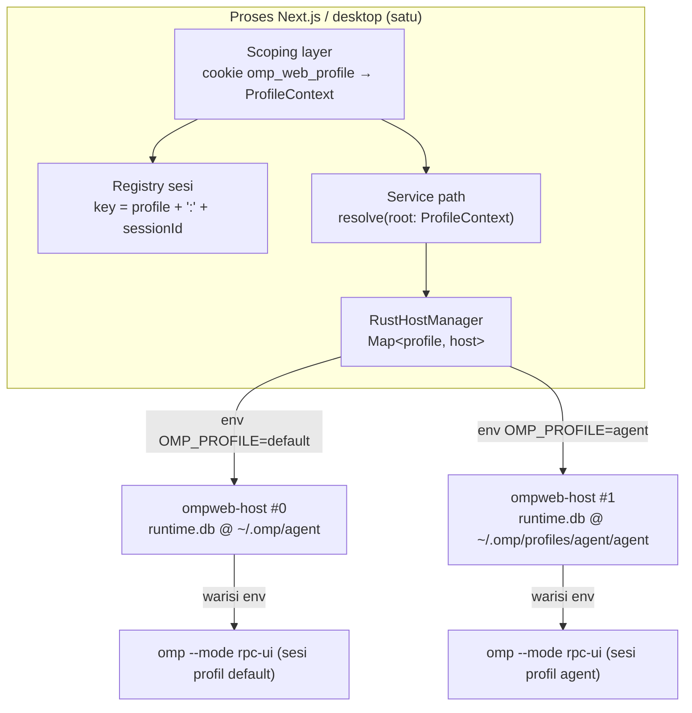

# OmpWeb — Multi-Profile Live (Opsi C)

| | |
|---|---|
| Branch | `feat/multi-profile-live` (dari `custom/stable-prod` @ `d5d0614`) |
| Baseline | ompweb `5.1.9`, Rust authority sudah cutover (`backend-ownership.yaml`) |
| Status | **selesai & terverifikasi** — Fase 0–9 mendarat; dua profil hidup paralel, teruji end-to-end |
| Non-goal | mengubah semantik profil di sisi engine `omp`; merger ke `main`; deploy |

## 1. Keputusan

Satu proses ompweb (Next server + desktop shell) melayani **banyak profil omp sekaligus**,
bukan satu profil per instance. Ganti profil = aksi instan per-tab, tanpa relaunch.

### Bentuk implementasi yang dipilih: host-per-profile, bukan host multi-tenant

OmpWeb saat ini mengasumsikan **satu agent-dir per proses**: satu Rust host, satu jurnal
`runtime.db`, satu `Supervisor.sessions`, satu set konstanta module-level. Cara naif untuk
mewujudkan Opsi C adalah membuat satu Rust host multi-tenant (re-key `sessionId` →
`profile:sessionId` di JS *dan* Rust, jurnal per profil di dalam satu proses, env per sesi di
`ompweb-protocol`). Itu menyerang inti arsitektur 5.1 yang baru ditutup.

Alternatif yang lebih murah dan sama-sama "live": **biarkan Rust host tetap single-tenant,
dan multiplexing dilakukan di lapisan Node** — satu proses host Rust per profil, dikelola
`Map<profileKey, RustHostManager>`.

Konsekuensi:

| Aspek | Host multi-tenant | Host-per-profile (dipilih) |
|---|---|---|
| Re-key registry Rust (`supervisor.rs:59`) | wajib | **tidak perlu** — tiap host punya map sendiri |
| Jurnal per profil dalam satu proses | wajib rekayasa ulang | **gratis** — `OMPWEB_RUNTIME_DB` sudah env-driven (`main.rs:149-152`) |
| Env `OMP_PROFILE` ke child `omp` | perlu field baru di protokol | **gratis** — child mewarisi env host (`Supervisor::new(bin, vec![])`, `main.rs:146`; `cmd.envs` hanya menambah, `supervisor.rs:139`) |
| IPC port + token | perlu namespacing | **gratis** — sudah per-host (`main.rs:131-145`) |
| Delta Rust | struktural | nyaris nol |
| Biaya runtime | 1 proses | N proses host (puluhan MB per host) |

Pertukarannya N proses host ekstra. Itu diterima: isolasinya total, failure domain-nya
bersih, dan tidak menyentuh kontrak 5.1.

## 2. Invariant keras

1. **Profil selalu di-resolve lewat `normalizeProfileName()`** (`lib/omp/paths.ts:28-45`) lalu
   dicocokkan terhadap allowlist direktori yang benar-benar ada. Nilai dari cookie adalah
   input tak tepercaya; tanpa allowlist ini jadi path traversal tembus ke containment Rust
   (`file_service.rs:183` `is_path_within_any`).
2. **Tidak ada lagi path agent-dir module-level.** Semua pembaca path harus menerima
   `ProfileContext` secara eksplisit. Konstanta yang dievaluasi saat import tidak bisa
   benar untuk dua profil sekaligus.
3. **Transport scoping = cookie, bukan header.** Klien pakai SSE/streaming (running-status
   broadcaster `lib/rpc-manager.ts:1359-1365`) yang tidak bisa memasang custom header.
   `app/api/sessions/route.ts:13` sudah mendeklarasikan `Vary: Cookie`.
4. **Semua kunci cache/ETag wajib mengandung profil.** ETag daftar sesi dihitung dari body
   (`app/api/sessions/route.ts:22`); tanpa profil di kunci, profil B bisa dapat 304 body
   profil A. Berlaku juga untuk cache scan sesi (`lib/omp/session-files.ts:986-1002`,
   `:1095-1115`) dan cache models in-memory `lib/models-cache.ts:53,90` — kunci cache itu
   adalah **`cwd`**, bukan profil, jadi dua profil pada satu cwd langsung bertabrakan dalam
   60 detik TTL.
5. **Rust host tetap single-tenant.** Dilarang menambah field profil ke `ompweb-protocol`
   atau ke kontrak IPC kecuali spike Fase 0 membuktikan tidak ada jalan lain.
6. **Jalur test isolasi tidak boleh kena.** `app/api/models-config/test/route.ts:57-64`
   sengaja mengosongkan `OMP_PROFILE`/`PI_PROFILE`/`XDG_DATA_HOME` agar temp dir menang.
   Scoping per-request harus hormat invariant itu.
7. **Tidak ada endpoint pembuatan profil di fase awal.** Direktori `profiles/<x>/agent`
   kosong tanpa `config.yml`/`models.yml`/`mcp.json` membuat UI setengah rusak. Provisioning
   harus lewat CLI `omp`, bukan `mkdir`.

## 3. Peta kode hari ini (evidence)

| Lapisan | Lokasi | Status profil |
|---|---|---|
| Resolver profil | `lib/omp/paths.ts:28-58` (`normalizeProfileName`, `getActiveProfile`, `getConfigDirName`) | sudah ada, valid |
| Root config/agent | `lib/omp/paths.ts:61-84` (`getConfigRoot`, `getAgentDir`) | profil-aware, tapi **proses-global via env** |
| XDG opt-in | `lib/omp/paths.ts:86-111` | profil-aware, ikut mengikat |
| Turunan path | `paths.ts:114-221` (`getSessionsDir`, `getArchivedSessionsDir`, `getBlobsDir`, `getSettingsPath`, `getModelsConfigPath`, `getUserSkillsDir`, `getUserAgentsDir`, `getAgentsBundledCacheDir`) | profil-aware |
| Pemanggil helper | **45 call site non-test di 20 file**: `agents-service.ts` 8, `api/diagnostics` 5, `session-files.ts` 4, `mcp-config.ts` 3, `archive.ts` 3, `api/reveal` 3, `skills-service.ts` 2, `project-registry.ts` 2, `api/sessions/import` 2, `api/sessions/[id]` 2, `api/agents` 2, `usage-summary.ts` 1, `session-watcher.ts` 1, `remote-pairing-store.ts` 1, `remote-pairing-mirror.ts` 1, `settings-config.ts` 1, `rust-rpc-process.ts` 1, `models-config.ts` 1, `model-roles.ts` 1, `api/models` 1 | perlu konteks |
| Spawn child `omp` | `crates/ompweb-host/src/supervisor.rs:78-139` | env dari host, bukan per-sesi |
| Konstruktor supervisor | `crates/ompweb-host/src/main.rs:146` (`vec![]`) | warisi env host |
| Path jurnal runtime | `main.rs:149-152`; di-set Node di `lib/omp/rust-rpc-process.ts:208` | env-driven, single per proses |
| Manajer host | `lib/omp/rust-rpc-process.ts:529` (`const hostManager = new RustHostManager()`) | **singleton** |
| Registry sesi JS | `lib/rpc-manager.ts:1311-1324` (`globalThis.__ompSessions`, key = sessionId) | tabung profil |
| Daftar sesi hidup | `lib/rpc-manager.ts:1336-1342` | tanpa dimensi profil |
| Baca daftar sesi | `app/api/sessions/route.ts:18-26`; `lib/omp/host-client.ts:139` (`session.scan` + `root`) | root sudah parameterized |
| Scan Rust | `crates/ompweb-host/src/session_scan.rs:359` (`scan_root(root)`) | sudah netral profil |
| Scoping HTTP | `proxy.ts:6` import `getAgentDir` (pairing), `lib/web-auth.ts:3` (`omp_web_session`) | belum ada konsep profil |
| Middleware | tidak ada `middleware.ts` | — |
| UI | tidak ada permukaan profil | belum ada |
| Desktop launcher | `desktop/main.js:22-28,399-409`; `bin/omp-web-desktop.js:91-95` | tidak menyuntik profil |
| Registry proyek | `lib/project-registry.ts:88,100` (`projects.json` di agent-dir) | resolve per-panggilan via `getAgentDir()` → otomatis ikut profil |
| Skills / agents / MCP / pairing / watcher | `lib/skills-service.ts:85,256`, `lib/omp/agents-service.ts:75,77,78,178,330,341,342`, `lib/omp/mcp-config.ts:46`, `lib/remote-pairing-store.ts:19`, `lib/remote-pairing-mirror.ts:16`, `lib/session-watcher.ts:91`, `lib/usage-summary.ts:177` | resolve per-panggilan, tapi tanpa dimensi profil |
| Cache models | `lib/models-cache.ts:53,90` (in-memory, key = `cwd`, TTL 60 dtk) | **bukan** file `models.db`; tabrakan antar profil pada cwd sama |
| Path **hardcode** melewati resolver (bahaya) | `lib/project-scripts.ts:26` (`~/.omp/agent/scripts.json`), `lib/proxy-config.ts:32` (`~/.omp/agent/proxy.json`), `lib/stats-aggregate.ts:107` + `lib/usage-summary.ts:138` + `app/api/usage/logs/route.ts:17` (`~/.omp/stats.db`) | **tidak profil-aware sama sekali** — harus diputuskan global vs per profil (D-6) |
| Backend Node (fallback) | `lib/omp/rpc-process.ts:70-71,120-125` (`options.env` di-merge di atas `process.env`) | sudah bisa per-instance; hanya butuh dipasangi ctx |
| Test yang mengunci profil | `lib/project-registry.test.mjs:31-43`, `lib/rpc-manager.test.mjs` | pin perilaku env |

## 4. Fase kerja

### Fase 0 — Spike: buktikan premis host-per-profile — **LOLOS 15/15**

Harness sementara `spike-fase0.mjs` (dihapus setelah gate). Isolasi lewat
`PI_CONFIG_DIR=.omp-spike-fase0` dan `PI_CODING_AGENT_DIR` dihapus.

| Klaim | Hasil | Bukti |
|---|---|---|
| Dua `RustHostManager` koeksisten | ✅ | pid OS berbeda (8196 / 28364), `profileKey` `alpha`/`beta` |
| `runtime.db` per profil | ✅ | dua path berbeda, keduanya benar-benar dibuat di disk |
| Failure domain bersih | ✅ | `hostAlpha.shutdown()` → `hostBeta` tetap jawab `ping` |
| `session.scan` hormat root eksplisit | ✅ | scan root profil lain lewat host B sukses, tidak bocor |
| Orphan cleanup lintas profil | ✅ aman | `listOrphanRustHosts()` tidak menyertakan host hidup; `profileKey` diterima |
| `shutdownRustHost()` menyapu semua host | ✅ | — |

**Batasan yang dinyatakan:** klaim "child `omp` memakai agent-dir profil"
terverifikasi **tidak langsung** — env host terbukti ter-pin (jurnal dibuat di
path profil) dan `supervisor.rs:125-139` memakai `Command::new` tanpa
`env_clear()` dengan `omp_env` kosong → child mewarisi penuh. Belum diuji via
spawn sesi end-to-end dengan model sungguhan.

**Jebakan yang ditemukan:** `PI_CONFIG_DIR` adalah **nama direktori relatif ke
`$HOME`**, bukan path absolut. Salah tafsir membuat seluruh spike diam-diam
jatuh ke profil proses (`default/default/default`) dengan gejala membingungkan.

Gerbang: **LULUS** — lanjut dengan host-per-profile, tanpa perubahan `crates/**`.

**Temuan verifikasi Rust (Fase 9 sebagian):** `cargo test --workspace` di host
Windows ini gagal 2–3 test (`command_service::tests::wait_mode_*`,
`ipc_server::tests::oversized_no_newline_flood_*`) yang bergantung shell POSIX
(`printf`, `sleep 5 & wait`). `crates/` byte-identik dengan HEAD (`git status`
bersih) → kegagalan ini **pre-existing/environmental**, bukan akibat refactor.
51–52 test Rust lainnya lolos.

### Fase 1 — `ProfileContext` + allowlist discovery
File baru: `lib/omp/profile-context.ts`, `app/api/profiles/route.ts`.

- `listProfiles()`: `readdir(~/.omp/profiles)` → `statSync` → validasi
  `PROFILE_NAME_RE` + tolak `.`/`..`/nama reserved Windows → selalu sertakan `default`.
- `resolveProfileContext(name)`: hasilkan **semua** turunan path (agentDir, sessionsDir,
  blobsDir, archivedDir, settingsPath, modelsConfigPath, skillsDir, runtimeDbPath) dari
  resolver yang ada, bukan dari `join()` manual. Ini menjaga `PI_CODING_AGENT_DIR`,
  `PI_CONFIG_DIR`, dan XDG tetap benar.
- `countModels(ctx)` pakai service models yang ada (`lib/omp/models-config.ts:154`,
  `lib/models-cache.ts`) — **bukan** scan `models.yml`. Cache models adalah in-memory
  (`models-cache.ts:53,90`, key = `cwd`, TTL 60 dtk) dan ada runtime discovery, jadi scan
  file salah ukur **dan** cache-nya tabrakan antar profil pada cwd yang sama.
- `countSessions(ctx)` lewat `session.scan`/`listAllSessionInfos` yang sudah ada.
- Balas `sessionCount`, `modelCount`, `configPath`, `isDefault`. Tanpa `createdAt`
  (`~/.omp/profiles/<x>` tidak punya metadata andal).

Gerbang: unit test allowlist (traversal, `..`, `CON`, `agent.bak`, nama tidak ada) + route
mengembalikan 400 untuk nilai invalid, bukan 500.

### Fase 2 — Scoping request
File: `lib/omp/profile-cookie.ts` (baru), `proxy.ts`, `app/api/sessions/route.ts`,
`app/api/sessions/[id]/route.ts`, route lain yang menyentuh path profil.

- Cookie `omp_web_profile` (sibling `omp_web_session`, `lib/web-auth.ts:3`),
  `SameSite=Lax`, `HttpOnly`, path `/`, TTL panjang. Ditulis lewat route `/api/profile`
  (PUT), dibaca lewat helper tunggal.
- Helper `requestProfileContext(req)` → validasi → `ctx` atau fallback `default`.
  Satu titik masuk; dilarang baca cookie tersebar per-route.
- Pasang `Vary: Cookie` di semua route yang kini profil-scoped (pola sudah ada di
  `app/api/sessions/route.ts:11-14`).
- Sertakan profil pada kunci ETag dan pada `globalThis.__ompSessionFileListCache`.

Gerbang: dua cookie profil berbeda → dua body berbeda, dan `If-None-Match` silang profil
**tidak** menghasilkan 304.

### Fase 3 — Multiplexing host
File: `lib/omp/rust-rpc-process.ts` (utamanya `:46-95`, `:180-215`, `:529`).

- `hostManager` singleton → `Map<profileKey, RustHostManager>` di balik fungsi
  `hostFor(profile)`; semua pemanggil lama (`:561-716`, `:762`, `:769`) dialirkan lewat
  aksesor yang sama.
- Env spawn (`:205-208`) menjadi
  `{ ...process.env, OMP_PROFILE: ctx.profile ?? "", PI_PROFILE: undefined, PI_CODING_AGENT_DIR: ctx.agentDir, OMPWEB_RUNTIME_DB: ctx.runtimeDb }`.
  `OMP_PROFILE: ""` eksplisit penting: komentar `paths.ts:47-48` menyebut env kosong
  berarti "pilih default", bukan "warisi".
- `shutdown()` / `restartAllRpcSessions()` (`lib/rpc-manager.ts:1344-1352`) mengiterasi
  semua host.
- Tidak ada perubahan `crates/**`. Kalau spike Fase 0 memaksa, itu cabang terpisah.

Gerbang: dua profil hidup bersamaan; `runtime.db` masing-masing ada dan tidak saling
tulis; matikan satu host, host lain tetap hidup.

### Fase 4 — Registry sesi berdimensi profil
File: `lib/rpc-manager.ts` (`:1311-1352`, `:1336-1342`, plus pemanggil `startRpcSession`).

- Key registry: `${profile}:${sessionId}`; `AgentSessionWrapper` menyimpan `profile`.
- `getRunningRpcSessionIds()` → bentuk berprofil (`Map<profile, string[]>` atau daftar
  `{sessionId, profile}`), dan broadcaster SSE (`:1359-1365`) mengirim hanya subset profil
  klien.
- Idle destroy (`IDLE_DESTROY_MS`, `:40`) dan start-lock map (`:1328-1329`) ikut berprofil,
  supaya sesi profil A tidak menahan/membunuh sesi profil B.
- Reentrancy guard `dispose` (`:1265`, `:1297`, `:1428-1462`) diuji terhadap dua sesi
  **beda profil tapi id sama** — ini sumber bug paling mungkin.

Gerbang: sesi dengan UUID identik di dua profil tidak pernah berbagi child proses.

### Fase 5 — Thread `ProfileContext` ke seluruh pembaca path
Bukan "hapus konstanta module-level" (di fork ini hampir tidak ada), tapi memberi dimensi
profil pada resolusi yang hari ini proses-global. Urutan dari padat ke jarang
(jumlah call site riil, tabel §3):

1. `lib/omp/agents-service.ts` (8) — `:75,77,78,178,330,341,342`
2. `app/api/diagnostics/route.ts` (5) — `:104-108`
3. `lib/omp/session-files.ts` (4) — `:264,1022,1316,1329`
4. `lib/omp/mcp-config.ts` (3) `:46`; `lib/omp/archive.ts` (3) `:146,160`;
   `app/api/reveal/route.ts` (3) `:32-34`
5. `lib/skills-service.ts` (2) `:85,256`; `lib/project-registry.ts` (2) `:88,100`;
   `app/api/sessions/import/route.ts` (2) `:89`; `app/api/sessions/[id]/route.ts` (2)
   `:283,424`; `app/api/agents/route.ts` (2)
6. Sisanya 1 call site: `lib/usage-summary.ts:177`, `lib/session-watcher.ts:91`,
   `lib/remote-pairing-store.ts:19`, `lib/remote-pairing-mirror.ts:16`,
   `lib/omp/settings-config.ts:60`, `lib/omp/models-config.ts:154`,
   `lib/omp/model-roles.ts:10`, `lib/omp/rust-rpc-process.ts:208`,
   `app/api/models/route.ts:19`

- Tambah overload opsional pada helper `paths.ts` (`getAgentDir(ctx?)` dst.); default tanpa
  argumen = perilaku lama (profil proses), supaya migrasi bertahap dan `bisect`-able.
- **Keputusan produk — registry proyek.** `lib/project-registry.ts:88,100` menyimpan
  `projects.json` di dalam agent-dir, jadi hari ini ia ikut profil proses. Pilihan:
  (a) ikut profil request → daftar proyek berbeda per profil, isolasi penuh;
  (b) dipindah ke root bersama (`~/.omp/projects.json`) → satu daftar proyek lintas profil.
  Default rencana: **(a) ikut profil request**, konsisten dengan invariant 2; kalau pilih
  (b), catat di §6 dan sediakan migrasi letak file.
- `lib/remote-pairing-store.ts:19`, `lib/remote-pairing-mirror.ts:16`, `proxy.ts:6`:
  pairing/perangkat tetap **global** (keamanan akses), bukan per profil. Pengecualian ini
  harus dinyatakan eksplisit di kode, bukan kebetulan.
- **Wajib: berantas path hardcode.** `lib/project-scripts.ts:26`, `lib/proxy-config.ts:32`,
  `lib/stats-aggregate.ts:107`, `lib/usage-summary.ts:138`, `app/api/usage/logs/route.ts:17`
  membangun `~/.omp/...` tanpa melewati resolver, jadi mereka **buta profil** dan akan
  membaca/menulis state default walau klien memakai profil lain. Arahkan ke
  `resolveProfileContext` sesuai keputusan D-6 (§6). Ini prasyarat Fase 7, bukan pembersihan
  opsional.
- Jalankan `scripts/audit-backend-ownership.mjs --check` setelah setiap batch; perbarui
  `backend-ownership.yaml` kalau ada domain yang pindah otoritas.

Gerbang:

1. `grep` helper path tanpa argumen hanya tersisa di tempat yang diizinkan
   (default-context + pairing + jalur D-6 yang memang global).
2. Tidak ada lagi `join(homedir(), ".omp", ...)` di luar `lib/omp/paths.ts` (dicek dengan
   grep polos); komentar/teks UI dikecualikan.

### Fase 6 — Baca daftar sesi & agregasi
File: `app/api/sessions/route.ts`, `app/api/sessions/[id]/route.ts`,
`lib/omp/session-files.ts`, `lib/session-reader.ts`, `crates` bila perlu root kedua.

- Daftar sesi default = profil aktif klien.
- View "semua profil": gabung hasil `session.scan` per root (`session_scan.rs:359` sudah
  netral, `host-client.ts:139` sudah mengirim `root`). Tandai tiap baris dengan profil;
  baris lintas profil **read-only** (rename/delete/open diblokir; lihat keputusan D-3 §6).
- `app/api/sessions/import/route.ts` dan `app/api/archive*`: tujuan import/arsip harus
  eksplisit profil, jangan mengikuti profil terakhir yang di-klik.

Gerbang: sesi profil A tidak muncul di daftar profil B kecuali di view agregat.

### Fase 7 — UI
File: `components/` (selector), hook klien, sidebar, `app/api/profile/route.ts` (baru).

- Selector profil di sidebar: daftar dari `/api/profiles`, badge jumlah sesi/model,
  indikator profil per tab sesi yang sedang hidup.
- Ganti profil = PUT cookie lalu refresh daftar sesi; tanpa reload penuh aplikasi bila
  memungkinkan, tapi **wajib** meng-invalidasi cache klien per profil.
- Tanpa emoji, tanpa teks penjelas di bawah judul, ikon hanya kalau diminta eksplisit
  (aturan UI enterprise repo/user).
- Provisioning profil: tombol "Buat profil" **tidak** dibuat. Tampilkan instruksi CLI
  `omp --profile <name>` bila profil belum ada.

Gerbang: manual — buka dua tab dengan profil berbeda sekaligus, keduanya streaming
normal, tidak ada bocor sesi/model/log antar tab.

### Fase 8 — Keamanan & hardening
- Semua jalur baca profil lewat `resolveProfileContext`; tambahkan test integrasi
  "cookie jahat → 400/fallback default".
- Audit `Vary: Cookie` di seluruh route yang kini berprofil (85 route API; pakai
  `lib/api-inventory.test.mjs` sebagai gerbang statis).
- Pastikan `app/api/models-config/test/route.ts:57-64` tetap terisolasi (invariant 6).
- Rate-limit/validasi untuk `/api/profiles` (read-only, murah, tapi tetap input-driven).
- Cek rotasi/retensi `runtime.db` per profil (`crates/ompweb-host/src/main.rs:149-152`).

### Fase 9 — Gerbang verifikasi
- `bun run lint`, `tsc`, `cargo test`, suite JS yang ada (`lib/rpc-manager.test.mjs`,
  `lib/project-registry.test.mjs`, `lib/omp/*.test.mjs`) harus tetap hijau tanpa mengubah
  assertion yang sudah ada.
- Test baru, spesifik Opsi C (bukan tautologi):
  1. dua profil hidup paralel → dua `runtime.db` berbeda, dua host berbeda;
  2. sessionId identik beda profil → registry tidak bertabrakan;
  3. cookie profil invalid → fallback default + tidak ada path traversal;
  4. ETag silang profil → 200, bukan 304;
  5. `session.scan` root per profil → jumlah cocok dengan isi disk;
  6. matikan host profil A → host profil B dan sesinya tidak terganggu;
  7. **anti-bocor state global**: dengan cookie profil B, hasil `/api/usage*`,
     `/api/scripts`, `/api/models` dan daftar proyek **tidak** berasal dari
     `~/.omp/agent` default (menutup R-9 dan D-6).
- Smoke manual: dua browser profile berbeda (atau 1 biasa + 1 incognito) dengan cookie
  profil berbeda, keduanya kirim prompt bersamaan.

**Hasil gerbang (2026-10-16):**

| Gerbang | Hasil |
|---|---|
| `bun run typecheck` | 0 error |
| `bun run lint` | rc 0, 93 warning (semua pre-existing, 0 error) |
| Suite JS (148 file) | 751 test, 708 pass, 1 fail, 42 skipped |
| `node scripts/audit-client-api.mjs --check` | in sync (157 calls / 34 files) |
| `node scripts/audit-error-codes.mjs` | golden diperbarui: +`profile_unknown` (+13 locale key `errors.profile_unknown` di en/ja/zh-CN) |
| `cargo test --workspace` (di `crates/`) | 50 pass, 3 fail — POSIX-dependent, `crates/` bersih per `git status` |

Satu-satunya kegagalan JS (`session-reader` "links forked children…") adalah EPERM
pra-keberadaan pada `rmSync` direktori temp (host Rust memegang `<agentDir>/ompweb/runtime.db`);
sudah direproduksi identik di worktree baseline `d5d0614` dan lulus dengan
`OMPWEB_BACKEND=node`. Bukan regresi Opsi C.

Test permanen baru: `lib/omp/profile-isolation.test.mjs` (9 test: allowlist, traversal,
keterpisahan path per profil, `hostEnvFor`, presedensi scope, tanpa duplikat profil proses,
`scripts.json` per profil, cache daftar sesi per profil + invalidasi, `proxy.json` global)
dan `lib/omp/profile-host-concurrency.test.mjs` (3 test: dua host koeksisten, stop satu
tidak mengganggu yang lain, `shutdownRustHost` menyelesaikan semuanya).

Smoke end-to-end (dev server, env bersih, profil `default` + `agent` + `nonexistent`):

- `/api/sessions` per cookie: 163 / 23 / 0 sesi; irisan id antar profil = 0.
- `If-None-Match` dengan ETag profil A + cookie profil B → **200** (bukan 304); profil
  yang sama → 304.
- `?all=1` → `byProfile` tiga bucket, top-level tetap milik profil request.
- Cookie jahat `..%2Fagent` → fallback profil proses, tidak ada traversal.
- `/api/models`: 103 (default) vs 803 (agent) — katalog mengikuti profil, bukan proses.
- `ensure_session` di dua profil → dua `ompweb-host.exe` anak proses yang sama (3 host
  hidup), `runtime.db` terbuat di tiap `agentDir` profil sendiri.
- Dua tab browser paralel: masing-masing hanya melihat profilnya + blok read-only profil
  lain (163 baris ber-`title`, 0 di antaranya di dalam `button`/`a`/`[role=button]`).
- Switch profil di UI (PUT `/api/profile` → cookie `httpOnly; SameSite=Lax`) mengganti
  daftar, group agregat, dan membersihkan pane tanpa navigasi manual.

## 5. Risk register

| ID | Risiko | Dampak | Mitigasi |
|---|---|---|---|
| R-1 | N host Rust = N× memori | degradasi di mesin kecil | Fase 0 ukur; LRU idle-destroy per profil; dokumentasikan batasnya |
| R-2 | `cleanupOrphanRustHosts` membunuh host profil lain | sesi mati misterius | Fase 0 bukti; kunci orphan-deteksi pada token/port, bukan nama proses |
| R-3 | Bocor data antar profil lewat cache/ETag | **kebiasaan keamanan serius** | invariant 4 + audit `Vary` Fase 8 + test #4 |
| R-4 | Path traversal dari cookie | RCE-adjacent (baca sembarang file) | invariant 1 allowlist + test #3 |
| R-5 | Inkonsistensi `PI_CODING_AGENT_DIR` vs profil | split-brain ala GUI Electron | `resolveProfileContext` satu-satunya pembangun path; precedence `paths.ts:67-75` dipertahankan |
| R-6 | Kontrak IPC berubah | retak roadmap 5.1/R-route | invariant 5: tidak ada perubahan Rust; kalau perlu, cabang + ADR terpisah |
| R-7 | Keputusan registry proyek salah (`project-registry.ts:88,100`) | proyek hilang/muncul tiba-tiba antar profil | keputusan D-1 ditutup sebelum Fase 5; migrasi letak file disiapkan kalau pilih (b) |
| R-8 | Regresi test env yang sudah ada (`project-registry.test.mjs:31-43`, `models-config.test.mjs`) | CI merah | invariant 6; jalankan suite tiap batch Fase 5 |
| R-9 | Path hardcode `~/.omp/...` yang melewati resolver | profil B diam-diam baca/tulis state profil default (bocor lintas profil) | inventaris §3 baris "hardcode"; wajib dikonversi di Fase 5 sebelum Fase 7 |
| R-10 | Backend Node vs Rust berbeda perilaku env | hasil verifikasi bergantung `OMPWEB_BACKEND` | Fase 3 menangani keduanya (`rpc-process.ts:70-71,120-125` sudah mendukung `options.env`) |

## 6. Keputusan produk yang harus ditutup sebelum Fase 5

| # | Pertanyaan | Default rencana |
|---|---|---|
| D-1 | Registry proyek (`projects.json` di agent-dir): ikut profil request, atau dipindah ke root bersama? | ikut profil request |
| D-2 | Perangkat pairing & remote access: global atau per profil? | global (keamanan) |
| D-3 | Sesi profil lain: read-only saja, atau boleh dibuka? | read-only |
| D-4 | Profil aktif disimpan per-tab atau per-klien (cookie)? | per-klien, dengan override per-tab bila sudah ada state tab |
| D-5 | Jumlah profil serentak dibatasi? | ya, LRU + batas lunak (mis. 4 host hidup) |
| D-6 | `stats.db`, `proxy.json`, `scripts.json` (hardcode root-level `~/.omp`): ikut profil atau global? | `proxy.json` **global** (infra jaringan, seperti pairing); `stats.db` + `scripts.json` **ikut profil** (state pemakaian/perintah milik profil) |

D-1..D-6 ditutup sebelum eksekusi Fase 5; jawaban D-6 mengubah lingkup Fase 5 dan test #7.

## 7. Delta terhadap rencana v1 (kenapa berubah)

| v1 | Koreksi | Alasan |
|---|---|---|
| "hapus konstanta path module-level di ~10 service" | di fork ini hampir tidak ada konstanta semacam itu; pekerjaannya threading `ProfileContext` ke 45 call site + memberantas 5 path hardcode `join(homedir(), ".omp", …)` | inventaris §3 (hasil audit kode riil, bukan asumsi) |
| (tidak dibahas) | host-per-profile alih-alih satu Rust host multi-tenant | menghindari re-key registry Rust + rekayasa jurnal; Rust tetap single-tenant |
| tambah `--profile` di `lib/rpc-manager.ts` | env disuntik ke **host Rust** (`rust-rpc-process.ts:205-208`), child warisi | child di-spawn Rust (`supervisor.rs:125-139`), bukan JS |
| re-key registry JS + Rust | cukup registry JS (+ lifecycle) | host-per-profile membuat map Rust tetap per-profil secara alami |
| `POST /api/profiles` buat folder | drop; provisioning via CLI `omp` | folder kosong = UI setengah rusak |
| `modelCount` dari `models.yml` | dari service models + cache in-memory ber-kunci profil | cache `models-cache.ts` keyed `cwd` + runtime discovery |
| (tidak dibahas) | allowlist validasi + `Vary`/ETag keying + test isolasi model | R-3/R-4, invariant 1/4/6 |

## 8. Urutan commit yang diusulkan

1. `feat(omp): ProfileContext + allowlist discovery` (Fase 1)
2. `feat(api): /api/profiles read-only` (Fase 1)
3. `feat(http): cookie-scoped profile context + Vary` (Fase 2)
4. `feat(host): host-per-profile multiplexing + runtime db per profil` (Fase 3)
5. `feat(rpc): profile-keyed session registry + SSE subset` (Fase 4)
6. `refactor(paths): thread ProfileContext through N readers` (Fase 5, dipecah per kelompok file)
7. `feat(sessions): per-profile listing + cross-profile read-only view` (Fase 6)
8. `feat(ui): profile switcher` (Fase 7)
9. `test(profile): concurrency, isolation, traversal, ETag` (Fase 9)

Fase 0 tidak menghasilkan commit produksi; hasilnya catatan di file ini.
